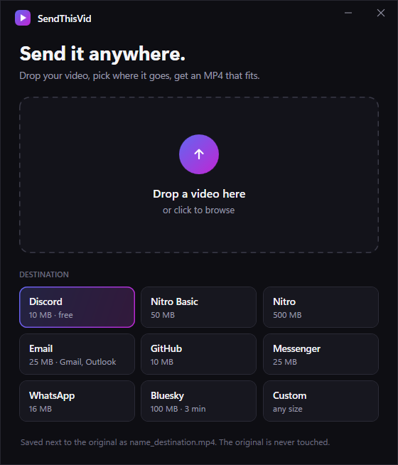
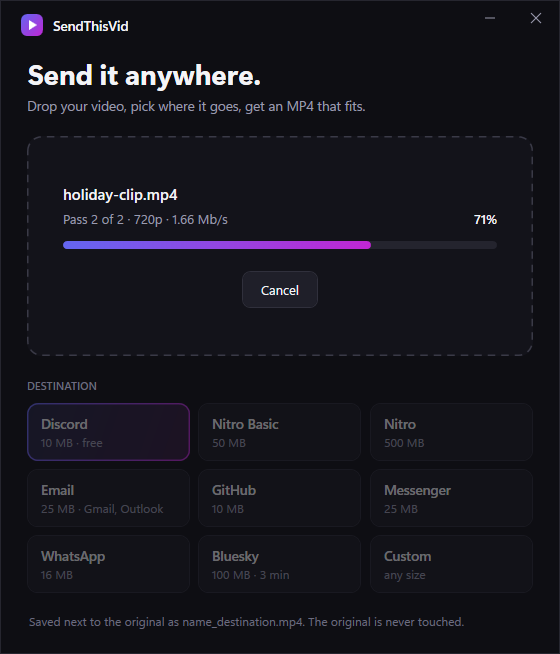
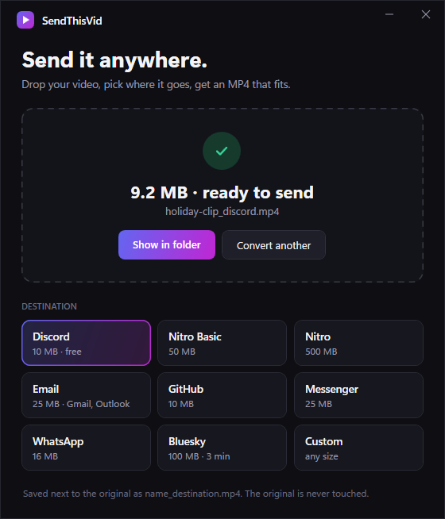

<p align="center">
  
</p>

<h1 align="center">SendThisVid</h1>

<p align="center">
  Drop a video, pick where it's going, get an MP4 that fits the upload limit.<br>
  One portable <code>.exe</code> for Windows 10 and 11. No install, no admin rights, nothing else to download.
</p>

<p align="center">
  
  
  
</p>

## Download

Grab **`SendThisVid.exe`** from the [latest release](../../releases/latest) and run it. That's it.

- Works on Windows 10 and 11 (64-bit), on a standard user account
- Runs from anywhere: Downloads, Desktop, a USB stick
- ffmpeg is built in

## How to use

1. Pick a destination under the drop zone (Discord, Email, GitHub, …). Your last choice is remembered.
2. Drag a video anywhere onto the window, or click the drop zone to browse.
3. When it's done, click **Show in folder**. Your file is selected and ready to drag into Discord or wherever.

The result is saved **next to the original** as `yourvideo_<destination>.mp4`. The original is never modified.

You can also drag a video onto `SendThisVid.exe` itself to open the app and start right away with your last destination.

## Presets

| Preset | Platform limit | SendThisVid aims for |
|---|---|---|
| Discord (free) | 10 MB | 9.5 MB |
| Discord Nitro Basic | 50 MB | 48 MB |
| Discord Nitro | 500 MB | 480 MB |
| Email (Gmail, Outlook) | 25 MB | 18 MB (attachments grow ~33% when emailed) |
| GitHub (issues, PRs, comments) | 10 MB | 9.5 MB |
| Messenger | 25 MB | 24 MB |
| WhatsApp | 16 MB | 15 MB |
| Bluesky | 100 MB, 3 min | 95 MB |
| Custom | — | any size you type, in MB |

Platforms change their limits from time to time. If one looks wrong, open an issue.

## How it works

SendThisVid works from the target size, not from a quality setting. That's why it can promise "under 10 MB".

1. Reads the video's duration and bitrate.
2. Computes the bitrate that fits the target, keeping 2% for the MP4 container. Audio gets 64 to 128 kb/s depending on the budget.
3. Picks a resolution the bitrate can carry (2160p, 1080p, 720p, 480p or 360p) and never upscales. It works on the short side, so portrait phone videos are handled correctly, including rotation metadata.
4. Encodes in two passes with H.264 and AAC, `yuv420p`, `+faststart`. That plays everywhere and previews inline in Discord.
5. Checks the real file size. If it overshoots, it re-encodes at a lower bitrate (up to 3 attempts).

If the source is already small, the bitrate is capped at the source's, so the file isn't inflated for nothing. If a video is far too long for the preset, SendThisVid says so instead of producing an unwatchable file.

## Where does it write?

- The output MP4, next to the source video.
- `%LOCALAPPDATA%\SendThisVid\`: the bundled ffmpeg, extracted once on first run (~100 MB), and your last preset.

To remove SendThisVid completely, delete the `.exe` and that folder.

## Signature and Windows SmartScreen

`SendThisVid.exe` is signed (SHA-256, DigiCert timestamp) with a **self-signed** certificate, publisher `CN=RyoSaeba89`. The signature proves the file hasn't been changed since it was built. But no recognized authority issued the certificate, so Windows doesn't trust it out of the box.

On first run, Windows may show *"Windows protected your PC"*: click **More info → Run anyway**.

**Optional: trust the publisher.** Do this once per PC, no admin rights needed. The signature then shows as valid in *Properties → Digital Signatures*. Download [`signing/SendThisVid-code-signing.cer`](signing/SendThisVid-code-signing.cer) and run:

```powershell
Import-Certificate -FilePath SendThisVid-code-signing.cer -CertStoreLocation Cert:\CurrentUser\Root
Import-Certificate -FilePath SendThisVid-code-signing.cer -CertStoreLocation Cert:\CurrentUser\TrustedPublisher
```

Windows asks for confirmation on the first command. Check that the thumbprint is `6CDFC84B3FB16FE8D34455414D96877B33884C61`.

## Command line

```
SendThisVid.exe <video> <target MB>
```

This encodes without showing a window and exits with code `0` (fits), `2` (over target) or `1` (error).

## Building from source

Requirements: Windows with PowerShell 7 (`pwsh`). No Visual Studio or .NET SDK needed. The build uses the C# compiler that ships with Windows (.NET Framework 4.x).

```powershell
pwsh .\build.ps1   # downloads a pinned, checksum-verified ffmpeg once, then builds SendThisVid.exe
pwsh .\test.ps1    # end-to-end tests (needs ffmpeg + ffprobe on PATH to generate sample clips)
```

**Code signing:** `build.ps1` signs and timestamps the exe with the maintainer's `CN=RyoSaeba89` certificate if it's in `Cert:\CurrentUser\My`. To use your own, set one of these first:

```powershell
$env:SIGN_CERT_THUMBPRINT = '<thumbprint of a code-signing cert in CurrentUser\My>'
# or
$env:SIGN_PFX = 'C:\path\cert.pfx'; $env:SIGN_PFX_PASSWORD = '...'
```

Without a certificate, the exe is built unsigned and you get a warning.

Other scripts:

- `assets/make-icon.ps1` regenerates the icon.
- `docs/screenshots.ps1` regenerates the README screenshots from the real app.

## License

SendThisVid is licensed under the [GNU GPL v3](LICENSE).

It bundles [FFmpeg](https://ffmpeg.org) (the [gyan.dev](https://www.gyan.dev/ffmpeg/builds/) "essentials" build, which includes x264), licensed under the GPL. FFmpeg's source code is available from [ffmpeg.org](https://ffmpeg.org/download.html), and the exact build used is pinned in `build.ps1`.
